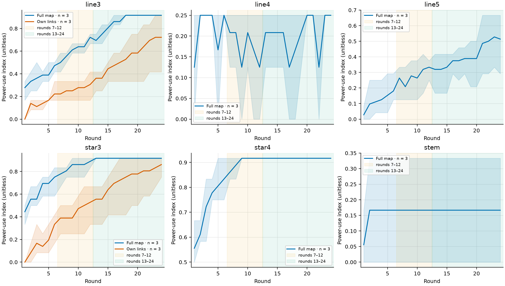

# Pilot report

## Provenance

| field | value |
| --- | --- |
| Configs | pilot_full_map, pilot_own_links |
| Configs excluded | — |
| Prompt versions | v1 |
| Quiz versions | q1 |
| Model IDs | gpt-6.1-terra |
| Git commits | b06c2dbb3010974ff9eb26373ce7beea0940fa71 |
| Dates (source started_at range) | 2026-11-02T13:25:03.753806+00:00 to 2026-11-02T13:35:37.463273+00:00 |

| condition_key | episodes |
| --- | --- |
| pilot_full_map/pair/full_map/terra | 3 |
| pilot_full_map/line3/full_map/terra | 3 |
| pilot_full_map/line4/full_map/terra | 3 |
| pilot_full_map/line5/full_map/terra | 3 |
| pilot_full_map/star3/full_map/terra | 3 |
| pilot_full_map/star4/full_map/terra | 3 |
| pilot_full_map/stem/full_map/terra | 3 |
| pilot_full_map/triangle/full_map/terra | 3 |
| pilot_own_links/line3/own_links/terra | 3 |
| pilot_own_links/star3/own_links/terra | 3 |

## Gate

| Check | Measure | Threshold | Value | PASS/FAIL |
| --- | --- | --- | --- | --- |
| G1: Run health | Abandoned episodes; failed / (completed + failed) | 0 abandoned; failed share ≤ 0.10 | 0 abandoned; failed share 0.00 | PASS |
| G2: No rule-breaking | Worst condition's invalid / asked turns | ≤ 0.02 in every condition | 0.00 | PASS |
| G3: Rules understood | Share scoring 3/3 | ≥ 0.90 | 1.00 | PASS |
| G4: Pair near 12/12 | Mean episode proposer share (second half) | 0.35 to 0.65 | 0.50 | PASS |
| G5: Game length | Own-links pilot window comparison | gap ≤ 0.1 on line3 and star3 → 12 rounds, otherwise 24 | 24 rounds | INFO |

Overall: **PASS**. Game length: **24 rounds**.

- Set `settings.rounds: 24` in the five study configs (minimum_study, own_links_arm, stretch_2c_sweep, stretch_2d_control, stretch_2f_h6), keep the pilot configs at 24, then run the minimum study.

## Learning curves

Advantaged-class power use by round, with episode-bootstrap 95% intervals and the two game-length windows.

| network | n_episodes | w_early | w_late | gap | within 0.1 |
| --- | --- | --- | --- | --- | --- |
| line3 | 3 | 0.26 | 0.55 | 0.29 | no |
| star3 | 3 | 0.44 | 0.73 | 0.29 | no |

w_early and w_late are the advantaged class's mean power-use index over rounds 7–12 and 13–24. The game stays at 12 rounds only if both gaps are within 0.1.

## Outcomes

### Class earnings, shares and predictions

### pair

| condition_key | node_class | n_episodes | points_mean | points_mean_ci_low | points_mean_ci_high | share_mean | share_mean_ci_low | share_mean_ci_high | equal_split | myerson | position_value | balanced |
| --- | --- | --- | --- | --- | --- | --- | --- | --- | --- | --- | --- | --- |
| pilot_full_map/pair/full_map/terra | A\|B | 3 | 12.00 | 12.00 | 12.00 | 0.50 | 0.50 | 0.50 | 12.00 | 12.00 | 12.00 | 12.00 |

### line3

| condition_key | node_class | n_episodes | points_mean | points_mean_ci_low | points_mean_ci_high | share_mean | share_mean_ci_low | share_mean_ci_high | equal_split | myerson | position_value | balanced |
| --- | --- | --- | --- | --- | --- | --- | --- | --- | --- | --- | --- | --- |
| pilot_full_map/line3/full_map/terra | A\|C | 3 | 0.81 | 0.71 | 0.92 | 0.07 | 0.06 | 0.07 | 6.00 | 4.00 | 6.00 | 0.00 |
| pilot_full_map/line3/full_map/terra | B | 3 | 22.39 | 22.17 | 22.58 | 0.93 | 0.92 | 0.94 | 12.00 | 16.00 | 12.00 | 24.00 |
| pilot_own_links/line3/own_links/terra | A\|C | 3 | 2.69 | 2.04 | 3.96 | 0.23 | 0.17 | 0.33 | 6.00 | 4.00 | 6.00 | 0.00 |
| pilot_own_links/line3/own_links/terra | B | 3 | 18.61 | 16.08 | 19.92 | 0.78 | 0.67 | 0.83 | 12.00 | 16.00 | 12.00 | 24.00 |

### line4

| condition_key | node_class | n_episodes | points_mean | points_mean_ci_low | points_mean_ci_high | share_mean | share_mean_ci_low | share_mean_ci_high | equal_split | myerson | position_value | balanced |
| --- | --- | --- | --- | --- | --- | --- | --- | --- | --- | --- | --- | --- |
| pilot_full_map/line4/full_map/terra | A\|D | 3 | 11.18 | 11.00 | 11.29 | 0.47 | 0.46 | 0.47 | 12.00 | 10.00 | 10.00 | 8.00 |
| pilot_full_map/line4/full_map/terra | B\|C | 3 | 12.82 | 12.71 | 13.00 | 0.53 | 0.53 | 0.54 | 12.00 | 14.00 | 14.00 | 16.00 |

### line5

| condition_key | node_class | n_episodes | points_mean | points_mean_ci_low | points_mean_ci_high | share_mean | share_mean_ci_low | share_mean_ci_high | equal_split | myerson | position_value | balanced |
| --- | --- | --- | --- | --- | --- | --- | --- | --- | --- | --- | --- | --- |
| pilot_full_map/line5/full_map/terra | A\|E | 3 | 5.78 | 4.42 | 7.21 | 0.31 | 0.25 | 0.40 | 8.00 | 5.20 | 7.00 | 0.00 |
| pilot_full_map/line5/full_map/terra | B\|D | 3 | 16.92 | 14.96 | 18.00 | 0.70 | 0.62 | 0.75 | 12.00 | 15.20 | 12.00 | 24.00 |
| pilot_full_map/line5/full_map/terra | C | 3 | 2.61 | 1.00 | 3.67 | 0.25 | 0.20 | 0.31 | 8.00 | 7.20 | 10.00 | 0.00 |

### star3

| condition_key | node_class | n_episodes | points_mean | points_mean_ci_low | points_mean_ci_high | share_mean | share_mean_ci_low | share_mean_ci_high | equal_split | myerson | position_value | balanced |
| --- | --- | --- | --- | --- | --- | --- | --- | --- | --- | --- | --- | --- |
| pilot_full_map/star3/full_map/terra | H | 3 | 23.00 | 23.00 | 23.00 | 0.96 | 0.96 | 0.96 | 12.00 | 18.00 | 12.00 | 24.00 |
| pilot_full_map/star3/full_map/terra | L1\|L2\|L3 | 3 | 0.33 | 0.33 | 0.33 | 0.04 | 0.04 | 0.04 | 4.00 | 2.00 | 4.00 | 0.00 |
| pilot_own_links/star3/own_links/terra | H | 3 | 20.78 | 17.92 | 22.25 | 0.87 | 0.75 | 0.93 | 12.00 | 18.00 | 12.00 | 24.00 |
| pilot_own_links/star3/own_links/terra | L1\|L2\|L3 | 3 | 1.07 | 0.58 | 2.03 | 0.13 | 0.08 | 0.25 | 4.00 | 2.00 | 4.00 | 0.00 |

### star4

| condition_key | node_class | n_episodes | points_mean | points_mean_ci_low | points_mean_ci_high | share_mean | share_mean_ci_low | share_mean_ci_high | equal_split | myerson | position_value | balanced |
| --- | --- | --- | --- | --- | --- | --- | --- | --- | --- | --- | --- | --- |
| pilot_full_map/star4/full_map/terra | H | 3 | 23.00 | 23.00 | 23.00 | 0.96 | 0.96 | 0.96 | 12.00 | 19.20 | 12.00 | 24.00 |
| pilot_full_map/star4/full_map/terra | L1\|L2\|L3\|L4 | 3 | 0.25 | 0.25 | 0.25 | 0.04 | 0.04 | 0.04 | 3.00 | 1.20 | 3.00 | 0.00 |

### stem

| condition_key | node_class | n_episodes | points_mean | points_mean_ci_low | points_mean_ci_high | share_mean | share_mean_ci_low | share_mean_ci_high | equal_split | myerson | position_value | balanced |
| --- | --- | --- | --- | --- | --- | --- | --- | --- | --- | --- | --- | --- |
| pilot_full_map/stem/full_map/terra | A | 3 | 11.00 | 10.00 | 12.00 | 0.46 | 0.42 | 0.50 | 12.00 | 8.00 | 9.00 | 6.00 |
| pilot_full_map/stem/full_map/terra | B | 3 | 13.00 | 12.00 | 14.00 | 0.54 | 0.50 | 0.58 | 12.00 | 16.00 | 15.00 | 18.00 |
| pilot_full_map/stem/full_map/terra | C\|D | 3 | 12.00 | 12.00 | 12.00 | 0.50 | 0.50 | 0.50 | 12.00 | 12.00 | 12.00 | 12.00 |

### triangle

| condition_key | node_class | n_episodes | points_mean | points_mean_ci_low | points_mean_ci_high | share_mean | share_mean_ci_low | share_mean_ci_high | equal_split | myerson | position_value | balanced |
| --- | --- | --- | --- | --- | --- | --- | --- | --- | --- | --- | --- | --- |
| pilot_full_map/triangle/full_map/terra | A\|B\|C | 3 | 8.00 | 8.00 | 8.00 | 0.49 | 0.48 | 0.50 | 8.00 | 8.00 | 8.00 | — |

### Power-use index

| condition_key | n_episodes | pui | pui_ci_low | pui_ci_high |
| --- | --- | --- | --- | --- |
| pilot_full_map/line3/full_map/terra | 3 | 0.87 | 0.85 | 0.88 |
| pilot_full_map/line4/full_map/terra | 3 | 0.20 | 0.18 | 0.25 |
| pilot_full_map/line5/full_map/terra | 3 | 0.41 | 0.25 | 0.50 |
| pilot_full_map/star3/full_map/terra | 3 | 0.92 | 0.92 | 0.92 |
| pilot_full_map/star4/full_map/terra | 3 | 0.92 | 0.92 | 0.92 |
| pilot_full_map/stem/full_map/terra | 3 | 0.17 | 0.00 | 0.33 |
| pilot_own_links/line3/own_links/terra | 3 | 0.55 | 0.34 | 0.66 |
| pilot_own_links/star3/own_links/terra | 3 | 0.73 | 0.49 | 0.85 |

## Diagnostics

Costs below are actual; completed and non-completed attempts are separate rows.

### Invalid moves and reasons

| condition_key | model_alias | n_asked | n_invalid | invalid_rate | by_reason |
| --- | --- | --- | --- | --- | --- |
| pilot_full_map/pair/full_map/terra | terra | 144 | 0 | 0.00 | — |
| pilot_full_map/line3/full_map/terra | terra | 285 | 0 | 0.00 | — |
| pilot_full_map/line4/full_map/terra | terra | 537 | 0 | 0.00 | — |
| pilot_full_map/line5/full_map/terra | terra | 501 | 0 | 0.00 | — |
| pilot_full_map/star3/full_map/terra | terra | 283 | 0 | 0.00 | — |
| pilot_full_map/star4/full_map/terra | terra | 326 | 0 | 0.00 | — |
| pilot_full_map/stem/full_map/terra | terra | 348 | 0 | 0.00 | — |
| pilot_full_map/triangle/full_map/terra | terra | 206 | 0 | 0.00 | — |
| pilot_own_links/line3/own_links/terra | terra | 245 | 0 | 0.00 | — |
| pilot_own_links/star3/own_links/terra | terra | 292 | 0 | 0.00 | — |

### Rules quiz

| condition_key | model_alias | n | mean_score | perfect_share | q1_accuracy | q2_accuracy | q3_accuracy |
| --- | --- | --- | --- | --- | --- | --- | --- |
| pilot_full_map/pair/full_map/terra | terra | 6 | 3.00 | 1.00 | 1.00 | 1.00 | 1.00 |
| pilot_full_map/line3/full_map/terra | terra | 9 | 3.00 | 1.00 | 1.00 | 1.00 | 1.00 |
| pilot_full_map/line4/full_map/terra | terra | 12 | 3.00 | 1.00 | 1.00 | 1.00 | 1.00 |
| pilot_full_map/line5/full_map/terra | terra | 15 | 3.00 | 1.00 | 1.00 | 1.00 | 1.00 |
| pilot_full_map/star3/full_map/terra | terra | 12 | 3.00 | 1.00 | 1.00 | 1.00 | 1.00 |
| pilot_full_map/star4/full_map/terra | terra | 15 | 3.00 | 1.00 | 1.00 | 1.00 | 1.00 |
| pilot_full_map/stem/full_map/terra | terra | 12 | 3.00 | 1.00 | 1.00 | 1.00 | 1.00 |
| pilot_full_map/triangle/full_map/terra | terra | 9 | 3.00 | 1.00 | 1.00 | 1.00 | 1.00 |
| pilot_own_links/line3/own_links/terra | terra | 9 | 3.00 | 1.00 | 1.00 | 1.00 | 1.00 |
| pilot_own_links/star3/own_links/terra | terra | 12 | 3.00 | 1.00 | 1.00 | 1.00 | 1.00 |

### Attempts and failure categories

| condition_key | abandoned_episodes | failed_attempts | interrupted_attempts | failed_by_category | non_completed_cost_usd |
| --- | --- | --- | --- | --- | --- |
| pilot_full_map/pair/full_map/terra | 0 | 0 | 0 | — | 0.0000 |
| pilot_full_map/line3/full_map/terra | 0 | 0 | 0 | — | 0.0000 |
| pilot_full_map/line4/full_map/terra | 0 | 0 | 0 | — | 0.0000 |
| pilot_full_map/line5/full_map/terra | 0 | 0 | 0 | — | 0.0000 |
| pilot_full_map/star3/full_map/terra | 0 | 0 | 0 | — | 0.0000 |
| pilot_full_map/star4/full_map/terra | 0 | 0 | 0 | — | 0.0000 |
| pilot_full_map/stem/full_map/terra | 0 | 0 | 0 | — | 0.0000 |
| pilot_full_map/triangle/full_map/terra | 0 | 0 | 0 | — | 0.0000 |
| pilot_own_links/line3/own_links/terra | 0 | 0 | 0 | — | 0.0000 |
| pilot_own_links/star3/own_links/terra | 0 | 0 | 0 | — | 0.0000 |

### Costs and usage

| config_name | model_alias | status | dry_run | calls | prompt_tokens | cached_tokens | cache_write_tokens | completion_tokens | reasoning_tokens | cost_usd |
| --- | --- | --- | --- | --- | --- | --- | --- | --- | --- | --- |
| pilot_full_map | terra | completed | no | 2721 | 2729684 | 0 | 0 | 99800 | 0 | 3.2287 |
| pilot_own_links | terra | completed | no | 558 | 542928 | 0 | 0 | 20973 | 0 | 0.6478 |
| total |  |  |  | 3279 | 3272612 | 0 | 0 | 120773 | 0 | 3.8765 |

### Pair proposer share

| condition_key | n_episodes | n_test | proposer_share | proposer_share_ci_low | proposer_share_ci_high | method | p_value |
| --- | --- | --- | --- | --- | --- | --- | --- |
| pilot_full_map/pair/full_map/terra | 3 | 3 | 0.50 | 0.50 | 0.50 | exact | 1 |

### Triangle lock-in

| condition_key | n_episodes | lock_in | lock_in_ci_low | lock_in_ci_high |
| --- | --- | --- | --- | --- |
| pilot_full_map/triangle/full_map/terra | 3 | 0.58 | 0.58 | 0.58 |

### Efficiency

| condition_key | n_episodes | efficiency | efficiency_ci_low | efficiency_ci_high |
| --- | --- | --- | --- | --- |
| pilot_full_map/pair/full_map/terra | 3 | 1.00 | 1.00 | 1.00 |
| pilot_full_map/line3/full_map/terra | 3 | 1.00 | 1.00 | 1.00 |
| pilot_full_map/line4/full_map/terra | 3 | 1.00 | 1.00 | 1.00 |
| pilot_full_map/line5/full_map/terra | 3 | 1.00 | 1.00 | 1.00 |
| pilot_full_map/star3/full_map/terra | 3 | 1.00 | 1.00 | 1.00 |
| pilot_full_map/star4/full_map/terra | 3 | 1.00 | 1.00 | 1.00 |
| pilot_full_map/stem/full_map/terra | 3 | 1.00 | 1.00 | 1.00 |
| pilot_full_map/triangle/full_map/terra | 3 | 1.00 | 1.00 | 1.00 |
| pilot_own_links/line3/own_links/terra | 3 | 1.00 | 1.00 | 1.00 |
| pilot_own_links/star3/own_links/terra | 3 | 1.00 | 1.00 | 1.00 |
