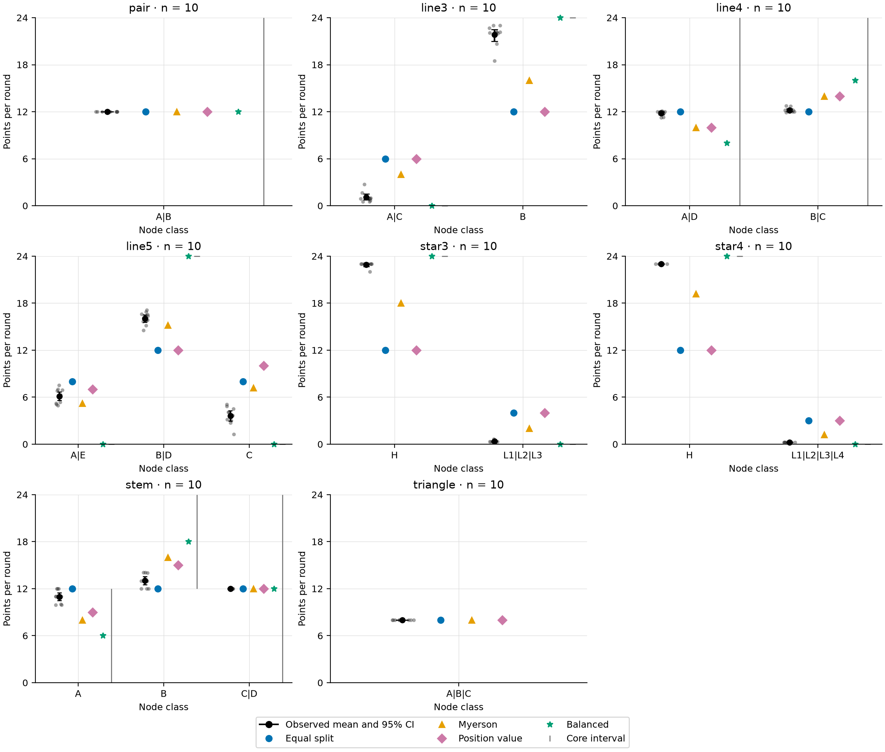
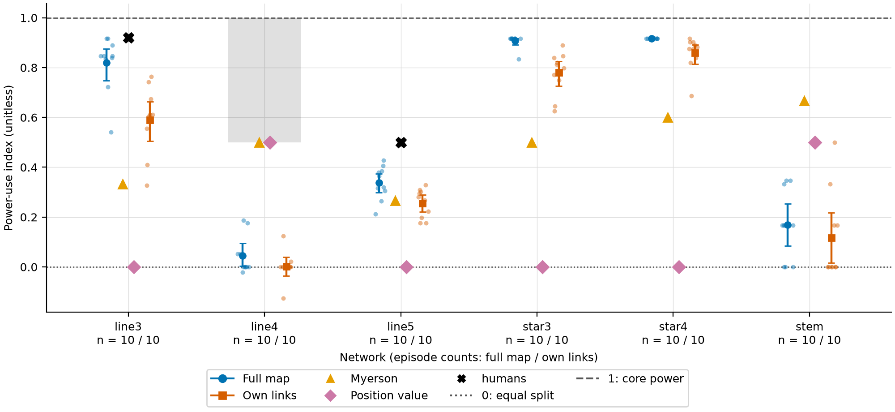
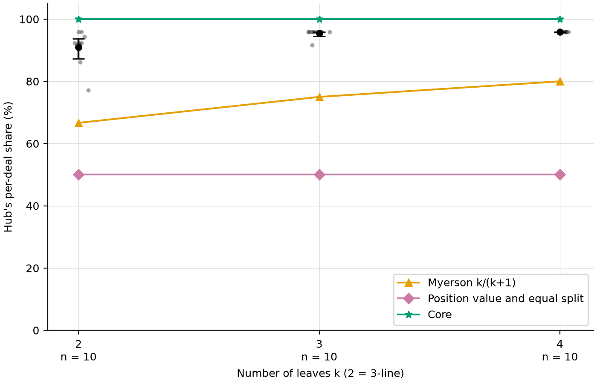
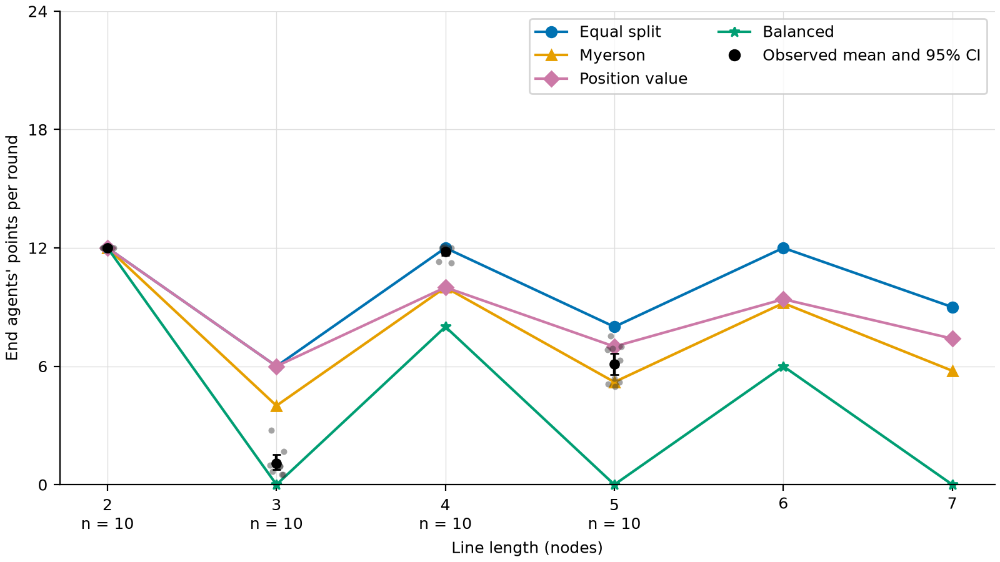

# Study report

## Provenance

| field | value |
| --- | --- |
| Configs | minimum_study, own_links_arm |
| Configs excluded | — |
| Prompt versions | v1 |
| Quiz versions | q1 |
| Model IDs | gpt-6.1-terra |
| Git commits | e5e52ea46adf34297147dea7c8587e7cef762f8d |
| Dates (source started_at range) | 2026-11-06T15:36:26.670198+00:00 to 2026-11-06T16:40:07.210429+00:00 |

| condition_key | episodes |
| --- | --- |
| minimum_study/pair/full_map/terra | 10 |
| minimum_study/line3/full_map/terra | 10 |
| minimum_study/line4/full_map/terra | 10 |
| minimum_study/line5/full_map/terra | 10 |
| minimum_study/star3/full_map/terra | 10 |
| minimum_study/star4/full_map/terra | 10 |
| minimum_study/stem/full_map/terra | 10 |
| minimum_study/triangle/full_map/terra | 10 |
| own_links_arm/pair/own_links/terra | 10 |
| own_links_arm/line3/own_links/terra | 10 |
| own_links_arm/line4/own_links/terra | 10 |
| own_links_arm/line5/own_links/terra | 10 |
| own_links_arm/star3/own_links/terra | 10 |
| own_links_arm/star4/own_links/terra | 10 |
| own_links_arm/stem/own_links/terra | 10 |
| own_links_arm/triangle/own_links/terra | 10 |

## Hypotheses

| Hypothesis | Data | Statistic | p | Holm-adjusted p | Decision |
| --- | --- | --- | --- | --- | --- |
| H1 | line3 (n = 10); line5 (n = 10); star3 (n = 10); star4 (n = 10) | 0.17 | 0.0009766 | 0.0009766 | supported |
| H3 | line3 (n = 10); star3 (n = 10); star4 (n = 10) | 0.02 | 3e-05 | 6e-05 | supported |
| H4 | line4 (n = 10); line5 (n = 10) | 5.70 | 5.413e-06 | 2.165e-05 | supported |
| H5 | line3 (n = 10); line4 (n = 10); line5 (n = 10); star3 (n = 10); star4 (n = 10); stem (n = 10) | 0.10 | 1e-05 | 3e-05 | supported |
| H6 | not run | — | — | — | not run |

### H1 secondary per-network analysis

| network | n | mean | ci_low | ci_high | p_value | p_adjusted | decision |
| --- | --- | --- | --- | --- | --- | --- | --- |
| line3 | 10 | 0.91 | 0.87 | 0.94 | 0.0009766 | 0.003906 | supported |
| line5 | 10 | 0.67 | 0.65 | 0.69 | 0.0009766 | 0.003906 | supported |
| star3 | 10 | 0.95 | 0.95 | 0.96 | 0.0009766 | 0.003906 | supported |
| star4 | 10 | 0.96 | 0.96 | 0.96 | 0.0009766 | 0.003906 | supported |

### H1 per-network inputs

| network | n | mean | ci_low | ci_high | method | alternative | n_resamples | statistic | p_value |
| --- | --- | --- | --- | --- | --- | --- | --- | --- | --- |
| line3 | 10 | 0.91 | 0.87 | 0.94 | exact | greater | 1024 | 0.41 | 0.0009766 |
| line5 | 10 | 0.67 | 0.65 | 0.69 | exact | greater | 1024 | 0.17 | 0.0009766 |
| star3 | 10 | 0.95 | 0.95 | 0.96 | exact | greater | 1024 | 0.45 | 0.0009766 |
| star4 | 10 | 0.96 | 0.96 | 0.96 | exact | greater | 1024 | 0.46 | 0.0009766 |

### H3 per-network inputs

| network | k | n | mean | ci_low | ci_high |
| --- | --- | --- | --- | --- | --- |
| line3 | 2 | 10 | 0.91 | 0.87 | 0.94 |
| star3 | 3 | 10 | 0.95 | 0.95 | 0.96 |
| star4 | 4 | 10 | 0.96 | 0.96 | 0.96 |

### H4 per-network inputs

| network | n | mean | ci_low | ci_high |
| --- | --- | --- | --- | --- |
| line4 | 10 | 11.82 | 11.63 | 11.99 |
| line5 | 10 | 6.12 | 5.58 | 6.68 |

### H5 per-network inputs

| network | full_map.n | full_map.mean | full_map.ci_low | full_map.ci_high | own_links.n | own_links.mean | own_links.ci_low | own_links.ci_high | difference | difference_ci_low | difference_ci_high |
| --- | --- | --- | --- | --- | --- | --- | --- | --- | --- | --- | --- |
| line3 | 10 | 0.82 | 0.75 | 0.88 | 10 | 0.59 | 0.51 | 0.66 | 0.23 | 0.13 | 0.33 |
| line4 | 10 | 0.04 | 0.00 | 0.09 | 10 | 0.00 | -0.04 | 0.04 | 0.04 | -0.01 | 0.10 |
| line5 | 10 | 0.34 | 0.30 | 0.38 | 10 | 0.26 | 0.22 | 0.29 | 0.08 | 0.03 | 0.13 |
| star3 | 10 | 0.91 | 0.89 | 0.92 | 10 | 0.78 | 0.72 | 0.83 | 0.13 | 0.08 | 0.18 |
| star4 | 10 | 0.92 | 0.92 | 0.92 | 10 | 0.86 | 0.82 | 0.89 | 0.06 | 0.03 | 0.10 |
| stem | 10 | 0.17 | 0.08 | 0.25 | 10 | 0.12 | 0.03 | 0.23 | 0.05 | -0.08 | 0.19 |

## Class outcomes (second half)

Observed points per round and per-deal share by node class, with episode-bootstrap 95% intervals, beside the four benchmarks.

### pair

| condition_key | node_class | n_episodes | points_mean | points_mean_ci_low | points_mean_ci_high | share_mean | share_mean_ci_low | share_mean_ci_high | equal_split | myerson | position_value | balanced |
| --- | --- | --- | --- | --- | --- | --- | --- | --- | --- | --- | --- | --- |
| minimum_study/pair/full_map/terra | A\|B | 10 | 12.00 | 12.00 | 12.00 | 0.50 | 0.50 | 0.50 | 12.00 | 12.00 | 12.00 | 12.00 |
| own_links_arm/pair/own_links/terra | A\|B | 10 | 12.00 | 12.00 | 12.00 | 0.50 | 0.50 | 0.50 | 12.00 | 12.00 | 12.00 | 12.00 |

### line3

| condition_key | node_class | n_episodes | points_mean | points_mean_ci_low | points_mean_ci_high | share_mean | share_mean_ci_low | share_mean_ci_high | equal_split | myerson | position_value | balanced |
| --- | --- | --- | --- | --- | --- | --- | --- | --- | --- | --- | --- | --- |
| minimum_study/line3/full_map/terra | A\|C | 10 | 1.08 | 0.75 | 1.53 | 0.09 | 0.06 | 0.14 | 6.00 | 4.00 | 6.00 | 0.00 |
| minimum_study/line3/full_map/terra | B | 10 | 21.84 | 20.97 | 22.50 | 0.91 | 0.87 | 0.94 | 12.00 | 16.00 | 12.00 | 24.00 |
| own_links_arm/line3/own_links/terra | A\|C | 10 | 2.46 | 2.01 | 2.98 | 0.22 | 0.18 | 0.25 | 6.00 | 4.00 | 6.00 | 0.00 |
| own_links_arm/line3/own_links/terra | B | 10 | 19.07 | 18.13 | 20.00 | 0.79 | 0.75 | 0.83 | 12.00 | 16.00 | 12.00 | 24.00 |

### line4

| condition_key | node_class | n_episodes | points_mean | points_mean_ci_low | points_mean_ci_high | share_mean | share_mean_ci_low | share_mean_ci_high | equal_split | myerson | position_value | balanced |
| --- | --- | --- | --- | --- | --- | --- | --- | --- | --- | --- | --- | --- |
| minimum_study/line4/full_map/terra | A\|D | 10 | 11.82 | 11.63 | 11.98 | 0.49 | 0.48 | 0.50 | 12.00 | 10.00 | 10.00 | 8.00 |
| minimum_study/line4/full_map/terra | B\|C | 10 | 12.18 | 12.02 | 12.38 | 0.51 | 0.50 | 0.52 | 12.00 | 14.00 | 14.00 | 16.00 |
| own_links_arm/line4/own_links/terra | A\|D | 10 | 11.99 | 11.85 | 12.14 | 0.50 | 0.49 | 0.51 | 12.00 | 10.00 | 10.00 | 8.00 |
| own_links_arm/line4/own_links/terra | B\|C | 10 | 12.01 | 11.86 | 12.15 | 0.50 | 0.49 | 0.51 | 12.00 | 14.00 | 14.00 | 16.00 |

### line5

| condition_key | node_class | n_episodes | points_mean | points_mean_ci_low | points_mean_ci_high | share_mean | share_mean_ci_low | share_mean_ci_high | equal_split | myerson | position_value | balanced |
| --- | --- | --- | --- | --- | --- | --- | --- | --- | --- | --- | --- | --- |
| minimum_study/line5/full_map/terra | A\|E | 10 | 6.12 | 5.59 | 6.66 | 0.33 | 0.32 | 0.36 | 8.00 | 5.20 | 7.00 | 0.00 |
| minimum_study/line5/full_map/terra | B\|D | 10 | 16.05 | 15.57 | 16.51 | 0.67 | 0.65 | 0.69 | 12.00 | 15.20 | 12.00 | 24.00 |
| minimum_study/line5/full_map/terra | C | 10 | 3.64 | 2.96 | 4.28 | 0.32 | 0.29 | 0.34 | 8.00 | 7.20 | 10.00 | 0.00 |
| own_links_arm/line5/own_links/terra | A\|E | 10 | 6.35 | 5.78 | 6.90 | 0.37 | 0.35 | 0.39 | 8.00 | 5.20 | 7.00 | 0.00 |
| own_links_arm/line5/own_links/terra | B\|D | 10 | 15.07 | 14.65 | 15.46 | 0.63 | 0.61 | 0.64 | 12.00 | 15.20 | 12.00 | 24.00 |
| own_links_arm/line5/own_links/terra | C | 10 | 5.16 | 4.40 | 5.94 | 0.37 | 0.33 | 0.39 | 8.00 | 7.20 | 10.00 | 0.00 |

### star3

| condition_key | node_class | n_episodes | points_mean | points_mean_ci_low | points_mean_ci_high | share_mean | share_mean_ci_low | share_mean_ci_high | equal_split | myerson | position_value | balanced |
| --- | --- | --- | --- | --- | --- | --- | --- | --- | --- | --- | --- | --- |
| minimum_study/star3/full_map/terra | H | 10 | 22.90 | 22.70 | 23.00 | 0.95 | 0.95 | 0.96 | 12.00 | 18.00 | 12.00 | 24.00 |
| minimum_study/star3/full_map/terra | L1\|L2\|L3 | 10 | 0.37 | 0.33 | 0.43 | 0.05 | 0.04 | 0.05 | 4.00 | 2.00 | 4.00 | 0.00 |
| own_links_arm/star3/own_links/terra | H | 10 | 21.36 | 20.74 | 21.93 | 0.89 | 0.86 | 0.91 | 12.00 | 18.00 | 12.00 | 24.00 |
| own_links_arm/star3/own_links/terra | L1\|L2\|L3 | 10 | 0.88 | 0.68 | 1.09 | 0.11 | 0.09 | 0.14 | 4.00 | 2.00 | 4.00 | 0.00 |

### star4

| condition_key | node_class | n_episodes | points_mean | points_mean_ci_low | points_mean_ci_high | share_mean | share_mean_ci_low | share_mean_ci_high | equal_split | myerson | position_value | balanced |
| --- | --- | --- | --- | --- | --- | --- | --- | --- | --- | --- | --- | --- |
| minimum_study/star4/full_map/terra | H | 10 | 23.00 | 23.00 | 23.00 | 0.96 | 0.96 | 0.96 | 12.00 | 19.20 | 12.00 | 24.00 |
| minimum_study/star4/full_map/terra | L1\|L2\|L3\|L4 | 10 | 0.25 | 0.25 | 0.25 | 0.04 | 0.04 | 0.04 | 3.00 | 1.20 | 3.00 | 0.00 |
| own_links_arm/star4/own_links/terra | H | 10 | 22.31 | 21.79 | 22.69 | 0.94 | 0.93 | 0.95 | 12.00 | 19.20 | 12.00 | 24.00 |
| own_links_arm/star4/own_links/terra | L1\|L2\|L3\|L4 | 10 | 0.37 | 0.32 | 0.43 | 0.06 | 0.05 | 0.08 | 3.00 | 1.20 | 3.00 | 0.00 |

### stem

| condition_key | node_class | n_episodes | points_mean | points_mean_ci_low | points_mean_ci_high | share_mean | share_mean_ci_low | share_mean_ci_high | equal_split | myerson | position_value | balanced |
| --- | --- | --- | --- | --- | --- | --- | --- | --- | --- | --- | --- | --- |
| minimum_study/stem/full_map/terra | A | 10 | 10.98 | 10.47 | 11.49 | 0.46 | 0.44 | 0.48 | 12.00 | 8.00 | 9.00 | 6.00 |
| minimum_study/stem/full_map/terra | B | 10 | 13.02 | 12.51 | 13.53 | 0.54 | 0.52 | 0.56 | 12.00 | 16.00 | 15.00 | 18.00 |
| minimum_study/stem/full_map/terra | C\|D | 10 | 12.00 | 12.00 | 12.00 | 0.50 | 0.50 | 0.50 | 12.00 | 12.00 | 12.00 | 12.00 |
| own_links_arm/stem/own_links/terra | A | 10 | 11.30 | 10.60 | 11.80 | 0.47 | 0.44 | 0.50 | 12.00 | 8.00 | 9.00 | 6.00 |
| own_links_arm/stem/own_links/terra | B | 10 | 12.70 | 12.20 | 13.40 | 0.53 | 0.50 | 0.55 | 12.00 | 16.00 | 15.00 | 18.00 |
| own_links_arm/stem/own_links/terra | C\|D | 10 | 12.00 | 12.00 | 12.00 | 0.50 | 0.50 | 0.50 | 12.00 | 12.00 | 12.00 | 12.00 |

### triangle

| condition_key | node_class | n_episodes | points_mean | points_mean_ci_low | points_mean_ci_high | share_mean | share_mean_ci_low | share_mean_ci_high | equal_split | myerson | position_value | balanced |
| --- | --- | --- | --- | --- | --- | --- | --- | --- | --- | --- | --- | --- |
| minimum_study/triangle/full_map/terra | A\|B\|C | 10 | 8.00 | 8.00 | 8.00 | 0.49 | 0.48 | 0.50 | 8.00 | 8.00 | 8.00 | — |
| own_links_arm/triangle/own_links/terra | A\|B\|C | 10 | 8.00 | 8.00 | 8.00 | 0.49 | 0.48 | 0.50 | 8.00 | 8.00 | 8.00 | — |

## H2: benchmark comparison

### Overall RMSE and P(best)

| predictor | n_classes | rmse | ci_low | ci_high | p_best |
| --- | --- | --- | --- | --- | --- |
| equal_split | 15 | 5.31 | 5.17 | 5.43 | 0.00 |
| myerson | 15 | 2.87 | 2.71 | 3.03 | 1.00 |
| position_value | 15 | 5.50 | 5.36 | 5.63 | 0.00 |
| balanced | 15 | 3.66 | 3.51 | 3.83 | 0.00 |

RMSE over the 15 classes where all four benchmarks are defined; left out: triangle (no balanced outcome).

Ranking: myerson, balanced, equal_split, position_value. Best benchmark: **myerson**.

### Per-network RMSE

| condition_key | predictor | n_episodes | n_classes | rmse | ci_low | ci_high |
| --- | --- | --- | --- | --- | --- | --- |
| minimum_study/pair/full_map/terra | equal_split | 10 | 1 | 0.00 | 0.00 | 0.00 |
| minimum_study/pair/full_map/terra | myerson | 10 | 1 | 0.00 | 0.00 | 0.00 |
| minimum_study/pair/full_map/terra | position_value | 10 | 1 | 0.00 | 0.00 | 0.00 |
| minimum_study/pair/full_map/terra | balanced | 10 | 1 | 0.00 | 0.00 | 0.00 |
| minimum_study/line3/full_map/terra | equal_split | 10 | 2 | 7.78 | 7.11 | 8.29 |
| minimum_study/line3/full_map/terra | myerson | 10 | 2 | 4.62 | 3.95 | 5.13 |
| minimum_study/line3/full_map/terra | position_value | 10 | 2 | 7.78 | 7.11 | 8.29 |
| minimum_study/line3/full_map/terra | balanced | 10 | 2 | 1.71 | 1.19 | 2.38 |
| minimum_study/line4/full_map/terra | equal_split | 10 | 2 | 0.18 | 0.02 | 0.37 |
| minimum_study/line4/full_map/terra | myerson | 10 | 2 | 1.82 | 1.63 | 1.98 |
| minimum_study/line4/full_map/terra | position_value | 10 | 2 | 1.82 | 1.63 | 1.98 |
| minimum_study/line4/full_map/terra | balanced | 10 | 2 | 3.82 | 3.63 | 3.98 |
| minimum_study/line5/full_map/terra | equal_split | 10 | 3 | 3.60 | 3.26 | 3.95 |
| minimum_study/line5/full_map/terra | myerson | 10 | 3 | 2.18 | 1.81 | 2.66 |
| minimum_study/line5/full_map/terra | position_value | 10 | 3 | 4.38 | 4.03 | 4.76 |
| minimum_study/line5/full_map/terra | balanced | 10 | 3 | 6.16 | 5.84 | 6.53 |
| minimum_study/star3/full_map/terra | equal_split | 10 | 2 | 8.12 | 7.98 | 8.20 |
| minimum_study/star3/full_map/terra | myerson | 10 | 2 | 3.65 | 3.50 | 3.73 |
| minimum_study/star3/full_map/terra | position_value | 10 | 2 | 8.12 | 7.98 | 8.20 |
| minimum_study/star3/full_map/terra | balanced | 10 | 2 | 0.82 | 0.75 | 0.97 |
| minimum_study/star4/full_map/terra | equal_split | 10 | 2 | 8.02 | 8.02 | 8.02 |
| minimum_study/star4/full_map/terra | myerson | 10 | 2 | 2.77 | 2.77 | 2.77 |
| minimum_study/star4/full_map/terra | position_value | 10 | 2 | 8.02 | 8.02 | 8.02 |
| minimum_study/star4/full_map/terra | balanced | 10 | 2 | 0.73 | 0.73 | 0.73 |
| minimum_study/stem/full_map/terra | equal_split | 10 | 3 | 0.83 | 0.42 | 1.25 |
| minimum_study/stem/full_map/terra | myerson | 10 | 3 | 2.44 | 2.02 | 2.85 |
| minimum_study/stem/full_map/terra | position_value | 10 | 3 | 1.62 | 1.20 | 2.03 |
| minimum_study/stem/full_map/terra | balanced | 10 | 3 | 4.07 | 3.65 | 4.48 |
| minimum_study/triangle/full_map/terra | equal_split | 10 | 1 | 0.00 | 0.00 | 0.00 |
| minimum_study/triangle/full_map/terra | myerson | 10 | 1 | 0.00 | 0.00 | 0.00 |
| minimum_study/triangle/full_map/terra | position_value | 10 | 1 | 0.00 | 0.00 | 0.00 |

### Distance to the core

| network_id | node_class | observed | core_min | core_max | distance |
| --- | --- | --- | --- | --- | --- |
| pair | A\|B | 12.00 | 0.00 | 24.00 | 0.00 |
| line3 | A\|C | 1.08 | 0.00 | 0.00 | 1.08 |
| line3 | B | 21.84 | 24.00 | 24.00 | 2.16 |
| line4 | A\|D | 11.82 | 0.00 | 24.00 | 0.00 |
| line4 | B\|C | 12.18 | 0.00 | 24.00 | 0.00 |
| line5 | A\|E | 6.12 | 0.00 | 0.00 | 6.12 |
| line5 | B\|D | 16.05 | 24.00 | 24.00 | 7.95 |
| line5 | C | 3.64 | 0.00 | 0.00 | 3.64 |
| star3 | H | 22.90 | 24.00 | 24.00 | 1.10 |
| star3 | L1\|L2\|L3 | 0.37 | 0.00 | 0.00 | 0.37 |
| star4 | H | 23.00 | 24.00 | 24.00 | 1.00 |
| star4 | L1\|L2\|L3\|L4 | 0.25 | 0.00 | 0.00 | 0.25 |
| stem | A | 10.98 | 0.00 | 12.00 | 0.00 |
| stem | B | 13.02 | 12.00 | 24.00 | 0.00 |
| stem | C\|D | 12.00 | 0.00 | 24.00 | 0.00 |
| triangle | A\|B\|C | 8.00 | — | — | — |

### Ordering accuracy (four benchmarks, degree and betweenness)

| predictor | n_pairs | n_tied_observed | correct | accuracy | ci_low | ci_high |
| --- | --- | --- | --- | --- | --- | --- |
| equal_split | 10 | 0 | 7.5 | 0.75 | 0.75 | 0.75 |
| myerson | 10 | 0 | 9.0 | 0.90 | 0.90 | 0.90 |
| position_value | 10 | 0 | 9.0 | 0.90 | 0.90 | 0.90 |
| balanced | 10 | 0 | 9.5 | 0.95 | 0.95 | 0.95 |
| degree | 10 | 0 | 8.5 | 0.85 | 0.85 | 0.85 |
| betweenness | 10 | 0 | 7.5 | 0.75 | 0.75 | 0.75 |

| network_id | n_pairs | equal_split | myerson | position_value | balanced | degree | betweenness |
| --- | --- | --- | --- | --- | --- | --- | --- |
| line3 | 1 | 1.00 | 1.00 | 1.00 | 1.00 | 1.00 | 1.00 |
| line4 | 1 | 0.50 | 1.00 | 1.00 | 1.00 | 1.00 | 1.00 |
| line5 | 3 | 0.83 | 0.67 | 0.67 | 0.83 | 0.50 | 0.33 |
| star3 | 1 | 1.00 | 1.00 | 1.00 | 1.00 | 1.00 | 1.00 |
| star4 | 1 | 1.00 | 1.00 | 1.00 | 1.00 | 1.00 | 1.00 |
| stem | 3 | 0.50 | 1.00 | 1.00 | 1.00 | 1.00 | 0.83 |

Networks with a single class have no pairs and are left out: pair, triangle. Per-network intervals are in `analysis/ordering_accuracy.json`.

## Figures

F1. Episode class earnings and their mean/95% CI beside the four point benchmarks and core intervals.

F2. Power use by knowledge setting, with theory and human anchors: [Borch & Girard](https://www.cmu.edu/joss/content/articles/volume10/Borch) (3-line and 5-line), and [Kleinberg & Tardos (2008)](https://cs.cornell.edu/info/people/kleinber/stoc08-exchange.pdf) (4-line).

F3. Hub share versus leaf count, including the 3-line at k = 2, with Myerson, equal-split/position-value and core references.

F4. End-agent earnings for observed lines and all four point predictions for lengths 2–7.

## Mixed models

| predictor | n_obs | n_groups | intercept | intercept_se | pred | pred_se | slot1_norm | slot1_norm_se | log_likelihood | aic | converged | warnings | error |
| --- | --- | --- | --- | --- | --- | --- | --- | --- | --- | --- | --- | --- | --- |
| equal_split | 3240 | 70 | -16.26 | 0.61 | 2.77 | 0.01 | -0.10 | 0.08 | -6671.39 | 13352.77 | yes | — | — |
| myerson | 3240 | 70 | -2.25 | 0.13 | 1.25 | 0.01 | -0.03 | 0.11 | -7559.18 | 15128.36 | yes | — | — |
| position_value | 3240 | 70 | -10.99 | 0.46 | 2.20 | 0.02 | -0.00 | 0.16 | -8761.45 | 17532.89 | yes | — | — |
| balanced | 3240 | 70 | 2.54 | 0.13 | 0.72 | 0.01 | -0.01 | 0.13 | -8079.97 | 16169.95 | yes | — | — |

## Exploratory: stretch configs

Descriptive results for the stretch configs, outside the Holm family. H6 is in the hypothesis table.

No stretch configs in these logs.

## Robustness

| Hypothesis | Data | Statistic | p | Holm-adjusted p | Decision |
| --- | --- | --- | --- | --- | --- |
| H1 | line3 (n = 10); line5 (n = 10); star3 (n = 10); star4 (n = 10) | 0.17 | 0.0009766 | 0.0009766 | supported |
| H3 | line3 (n = 10); star3 (n = 10); star4 (n = 10) | 0.03 | 3e-05 | 6e-05 | supported |
| H4 | line4 (n = 10); line5 (n = 10) | 5.73 | 5.413e-06 | 2.165e-05 | supported |
| H5 | line3 (n = 10); line4 (n = 10); line5 (n = 10); star3 (n = 10); star4 (n = 10); stem (n = 10) | 0.10 | 1e-05 | 3e-05 | supported |
| H6 | not run | — | — | — | not run |

### Class outcomes without the last round

#### pair

| condition_key | node_class | n_episodes | points_mean | points_mean_ci_low | points_mean_ci_high | share_mean | share_mean_ci_low | share_mean_ci_high | equal_split | myerson | position_value | balanced |
| --- | --- | --- | --- | --- | --- | --- | --- | --- | --- | --- | --- | --- |
| minimum_study/pair/full_map/terra | A\|B | 10 | 12.00 | 12.00 | 12.00 | 0.50 | 0.50 | 0.50 | 12.00 | 12.00 | 12.00 | 12.00 |
| own_links_arm/pair/own_links/terra | A\|B | 10 | 12.00 | 12.00 | 12.00 | 0.50 | 0.50 | 0.50 | 12.00 | 12.00 | 12.00 | 12.00 |

#### line3

| condition_key | node_class | n_episodes | points_mean | points_mean_ci_low | points_mean_ci_high | share_mean | share_mean_ci_low | share_mean_ci_high | equal_split | myerson | position_value | balanced |
| --- | --- | --- | --- | --- | --- | --- | --- | --- | --- | --- | --- | --- |
| minimum_study/line3/full_map/terra | A\|C | 10 | 1.12 | 0.77 | 1.58 | 0.10 | 0.07 | 0.14 | 6.00 | 4.00 | 6.00 | 0.00 |
| minimum_study/line3/full_map/terra | B | 10 | 21.76 | 20.87 | 22.45 | 0.91 | 0.87 | 0.94 | 12.00 | 16.00 | 12.00 | 24.00 |
| own_links_arm/line3/own_links/terra | A\|C | 10 | 2.59 | 2.14 | 3.09 | 0.22 | 0.19 | 0.26 | 6.00 | 4.00 | 6.00 | 0.00 |
| own_links_arm/line3/own_links/terra | B | 10 | 18.82 | 17.91 | 19.74 | 0.78 | 0.74 | 0.82 | 12.00 | 16.00 | 12.00 | 24.00 |

#### line4

| condition_key | node_class | n_episodes | points_mean | points_mean_ci_low | points_mean_ci_high | share_mean | share_mean_ci_low | share_mean_ci_high | equal_split | myerson | position_value | balanced |
| --- | --- | --- | --- | --- | --- | --- | --- | --- | --- | --- | --- | --- |
| minimum_study/line4/full_map/terra | A\|D | 10 | 11.84 | 11.65 | 12.00 | 0.49 | 0.49 | 0.50 | 12.00 | 10.00 | 10.00 | 8.00 |
| minimum_study/line4/full_map/terra | B\|C | 10 | 12.16 | 12.00 | 12.36 | 0.51 | 0.50 | 0.51 | 12.00 | 14.00 | 14.00 | 16.00 |
| own_links_arm/line4/own_links/terra | A\|D | 10 | 11.99 | 11.85 | 12.14 | 0.50 | 0.49 | 0.51 | 12.00 | 10.00 | 10.00 | 8.00 |
| own_links_arm/line4/own_links/terra | B\|C | 10 | 12.01 | 11.86 | 12.15 | 0.50 | 0.49 | 0.51 | 12.00 | 14.00 | 14.00 | 16.00 |

#### line5

| condition_key | node_class | n_episodes | points_mean | points_mean_ci_low | points_mean_ci_high | share_mean | share_mean_ci_low | share_mean_ci_high | equal_split | myerson | position_value | balanced |
| --- | --- | --- | --- | --- | --- | --- | --- | --- | --- | --- | --- | --- |
| minimum_study/line5/full_map/terra | A\|E | 10 | 6.11 | 5.60 | 6.64 | 0.34 | 0.32 | 0.36 | 8.00 | 5.20 | 7.00 | 0.00 |
| minimum_study/line5/full_map/terra | B\|D | 10 | 15.96 | 15.48 | 16.43 | 0.67 | 0.64 | 0.69 | 12.00 | 15.20 | 12.00 | 24.00 |
| minimum_study/line5/full_map/terra | C | 10 | 3.85 | 3.12 | 4.50 | 0.32 | 0.29 | 0.34 | 8.00 | 7.20 | 10.00 | 0.00 |
| own_links_arm/line5/own_links/terra | A\|E | 10 | 6.36 | 5.76 | 6.96 | 0.37 | 0.36 | 0.39 | 8.00 | 5.20 | 7.00 | 0.00 |
| own_links_arm/line5/own_links/terra | B\|D | 10 | 15.00 | 14.58 | 15.40 | 0.63 | 0.61 | 0.64 | 12.00 | 15.20 | 12.00 | 24.00 |
| own_links_arm/line5/own_links/terra | C | 10 | 5.27 | 4.52 | 6.04 | 0.37 | 0.34 | 0.40 | 8.00 | 7.20 | 10.00 | 0.00 |

#### star3

| condition_key | node_class | n_episodes | points_mean | points_mean_ci_low | points_mean_ci_high | share_mean | share_mean_ci_low | share_mean_ci_high | equal_split | myerson | position_value | balanced |
| --- | --- | --- | --- | --- | --- | --- | --- | --- | --- | --- | --- | --- |
| minimum_study/star3/full_map/terra | H | 10 | 22.89 | 22.67 | 23.00 | 0.95 | 0.94 | 0.96 | 12.00 | 18.00 | 12.00 | 24.00 |
| minimum_study/star3/full_map/terra | L1\|L2\|L3 | 10 | 0.37 | 0.33 | 0.44 | 0.05 | 0.04 | 0.05 | 4.00 | 2.00 | 4.00 | 0.00 |
| own_links_arm/star3/own_links/terra | H | 10 | 21.23 | 20.58 | 21.83 | 0.88 | 0.86 | 0.91 | 12.00 | 18.00 | 12.00 | 24.00 |
| own_links_arm/star3/own_links/terra | L1\|L2\|L3 | 10 | 0.92 | 0.72 | 1.14 | 0.12 | 0.10 | 0.15 | 4.00 | 2.00 | 4.00 | 0.00 |

#### star4

| condition_key | node_class | n_episodes | points_mean | points_mean_ci_low | points_mean_ci_high | share_mean | share_mean_ci_low | share_mean_ci_high | equal_split | myerson | position_value | balanced |
| --- | --- | --- | --- | --- | --- | --- | --- | --- | --- | --- | --- | --- |
| minimum_study/star4/full_map/terra | H | 10 | 23.00 | 23.00 | 23.00 | 0.96 | 0.96 | 0.96 | 12.00 | 19.20 | 12.00 | 24.00 |
| minimum_study/star4/full_map/terra | L1\|L2\|L3\|L4 | 10 | 0.25 | 0.25 | 0.25 | 0.04 | 0.04 | 0.04 | 3.00 | 1.20 | 3.00 | 0.00 |
| own_links_arm/star4/own_links/terra | H | 10 | 22.25 | 21.68 | 22.66 | 0.94 | 0.93 | 0.95 | 12.00 | 19.20 | 12.00 | 24.00 |
| own_links_arm/star4/own_links/terra | L1\|L2\|L3\|L4 | 10 | 0.38 | 0.33 | 0.45 | 0.07 | 0.06 | 0.08 | 3.00 | 1.20 | 3.00 | 0.00 |

#### stem

| condition_key | node_class | n_episodes | points_mean | points_mean_ci_low | points_mean_ci_high | share_mean | share_mean_ci_low | share_mean_ci_high | equal_split | myerson | position_value | balanced |
| --- | --- | --- | --- | --- | --- | --- | --- | --- | --- | --- | --- | --- |
| minimum_study/stem/full_map/terra | A | 10 | 11.00 | 10.50 | 11.50 | 0.46 | 0.44 | 0.48 | 12.00 | 8.00 | 9.00 | 6.00 |
| minimum_study/stem/full_map/terra | B | 10 | 13.00 | 12.50 | 13.50 | 0.54 | 0.52 | 0.56 | 12.00 | 16.00 | 15.00 | 18.00 |
| minimum_study/stem/full_map/terra | C\|D | 10 | 12.00 | 12.00 | 12.00 | 0.50 | 0.50 | 0.50 | 12.00 | 12.00 | 12.00 | 12.00 |
| own_links_arm/stem/own_links/terra | A | 10 | 11.30 | 10.60 | 11.80 | 0.47 | 0.44 | 0.50 | 12.00 | 8.00 | 9.00 | 6.00 |
| own_links_arm/stem/own_links/terra | B | 10 | 12.70 | 12.20 | 13.40 | 0.53 | 0.50 | 0.55 | 12.00 | 16.00 | 15.00 | 18.00 |
| own_links_arm/stem/own_links/terra | C\|D | 10 | 12.00 | 12.00 | 12.00 | 0.50 | 0.50 | 0.50 | 12.00 | 12.00 | 12.00 | 12.00 |

#### triangle

| condition_key | node_class | n_episodes | points_mean | points_mean_ci_low | points_mean_ci_high | share_mean | share_mean_ci_low | share_mean_ci_high | equal_split | myerson | position_value | balanced |
| --- | --- | --- | --- | --- | --- | --- | --- | --- | --- | --- | --- | --- |
| minimum_study/triangle/full_map/terra | A\|B\|C | 10 | 8.00 | 8.00 | 8.00 | 0.49 | 0.48 | 0.50 | 8.00 | 8.00 | 8.00 | — |
| own_links_arm/triangle/own_links/terra | A\|B\|C | 10 | 8.00 | 8.00 | 8.00 | 0.49 | 0.48 | 0.50 | 8.00 | 8.00 | 8.00 | — |

## Diagnostics

Costs below are actual; completed and non-completed attempts are separate rows.

### Invalid moves and reasons

| condition_key | model_alias | n_asked | n_invalid | invalid_rate | by_reason |
| --- | --- | --- | --- | --- | --- |
| minimum_study/pair/full_map/terra | terra | 480 | 0 | 0.00 | — |
| minimum_study/line3/full_map/terra | terra | 881 | 0 | 0.00 | — |
| minimum_study/line4/full_map/terra | terra | 1708 | 0 | 0.00 | — |
| minimum_study/line5/full_map/terra | terra | 1553 | 0 | 0.00 | — |
| minimum_study/star3/full_map/terra | terra | 906 | 0 | 0.00 | — |
| minimum_study/star4/full_map/terra | terra | 991 | 0 | 0.00 | — |
| minimum_study/stem/full_map/terra | terra | 1373 | 0 | 0.00 | — |
| minimum_study/triangle/full_map/terra | terra | 622 | 0 | 0.00 | — |
| own_links_arm/pair/own_links/terra | terra | 592 | 0 | 0.00 | — |
| own_links_arm/line3/own_links/terra | terra | 847 | 0 | 0.00 | — |
| own_links_arm/line4/own_links/terra | terra | 1361 | 0 | 0.00 | — |
| own_links_arm/line5/own_links/terra | terra | 1416 | 0 | 0.00 | — |
| own_links_arm/star3/own_links/terra | terra | 1026 | 0 | 0.00 | — |
| own_links_arm/star4/own_links/terra | terra | 1145 | 0 | 0.00 | — |
| own_links_arm/stem/own_links/terra | terra | 1378 | 0 | 0.00 | — |
| own_links_arm/triangle/own_links/terra | terra | 722 | 0 | 0.00 | — |

### Rules quiz

| condition_key | model_alias | n | mean_score | perfect_share | q1_accuracy | q2_accuracy | q3_accuracy |
| --- | --- | --- | --- | --- | --- | --- | --- |
| minimum_study/pair/full_map/terra | terra | 20 | 3.00 | 1.00 | 1.00 | 1.00 | 1.00 |
| minimum_study/line3/full_map/terra | terra | 30 | 3.00 | 1.00 | 1.00 | 1.00 | 1.00 |
| minimum_study/line4/full_map/terra | terra | 40 | 3.00 | 1.00 | 1.00 | 1.00 | 1.00 |
| minimum_study/line5/full_map/terra | terra | 50 | 3.00 | 1.00 | 1.00 | 1.00 | 1.00 |
| minimum_study/star3/full_map/terra | terra | 40 | 3.00 | 1.00 | 1.00 | 1.00 | 1.00 |
| minimum_study/star4/full_map/terra | terra | 50 | 3.00 | 1.00 | 1.00 | 1.00 | 1.00 |
| minimum_study/stem/full_map/terra | terra | 40 | 3.00 | 1.00 | 1.00 | 1.00 | 1.00 |
| minimum_study/triangle/full_map/terra | terra | 30 | 3.00 | 1.00 | 1.00 | 1.00 | 1.00 |
| own_links_arm/pair/own_links/terra | terra | 20 | 3.00 | 1.00 | 1.00 | 1.00 | 1.00 |
| own_links_arm/line3/own_links/terra | terra | 30 | 3.00 | 1.00 | 1.00 | 1.00 | 1.00 |
| own_links_arm/line4/own_links/terra | terra | 40 | 3.00 | 1.00 | 1.00 | 1.00 | 1.00 |
| own_links_arm/line5/own_links/terra | terra | 50 | 3.00 | 1.00 | 1.00 | 1.00 | 1.00 |
| own_links_arm/star3/own_links/terra | terra | 40 | 3.00 | 1.00 | 1.00 | 1.00 | 1.00 |
| own_links_arm/star4/own_links/terra | terra | 50 | 3.00 | 1.00 | 1.00 | 1.00 | 1.00 |
| own_links_arm/stem/own_links/terra | terra | 40 | 3.00 | 1.00 | 1.00 | 1.00 | 1.00 |
| own_links_arm/triangle/own_links/terra | terra | 30 | 3.00 | 1.00 | 1.00 | 1.00 | 1.00 |

### Attempts and failure categories

| condition_key | abandoned_episodes | failed_attempts | interrupted_attempts | failed_by_category | non_completed_cost_usd |
| --- | --- | --- | --- | --- | --- |
| minimum_study/pair/full_map/terra | 0 | 0 | 0 | — | 0.0000 |
| minimum_study/line3/full_map/terra | 0 | 0 | 0 | — | 0.0000 |
| minimum_study/line4/full_map/terra | 0 | 0 | 0 | — | 0.0000 |
| minimum_study/line5/full_map/terra | 0 | 0 | 0 | — | 0.0000 |
| minimum_study/star3/full_map/terra | 0 | 0 | 0 | — | 0.0000 |
| minimum_study/star4/full_map/terra | 0 | 0 | 0 | — | 0.0000 |
| minimum_study/stem/full_map/terra | 0 | 0 | 0 | — | 0.0000 |
| minimum_study/triangle/full_map/terra | 0 | 0 | 0 | — | 0.0000 |
| own_links_arm/pair/own_links/terra | 0 | 0 | 0 | — | 0.0000 |
| own_links_arm/line3/own_links/terra | 0 | 0 | 0 | — | 0.0000 |
| own_links_arm/line4/own_links/terra | 0 | 0 | 0 | — | 0.0000 |
| own_links_arm/line5/own_links/terra | 0 | 0 | 0 | — | 0.0000 |
| own_links_arm/star3/own_links/terra | 0 | 0 | 0 | — | 0.0000 |
| own_links_arm/star4/own_links/terra | 0 | 0 | 0 | — | 0.0000 |
| own_links_arm/stem/own_links/terra | 0 | 0 | 0 | — | 0.0000 |
| own_links_arm/triangle/own_links/terra | 0 | 0 | 0 | — | 0.0000 |

### Costs and usage

| config_name | model_alias | status | dry_run | calls | prompt_tokens | cached_tokens | cache_write_tokens | completion_tokens | reasoning_tokens | cost_usd |
| --- | --- | --- | --- | --- | --- | --- | --- | --- | --- | --- |
| minimum_study | terra | completed | no | 8814 | 8741588 | 0 | 0 | 324018 | 0 | 10.3617 |
| own_links_arm | terra | completed | no | 8787 | 8341334 | 0 | 0 | 323973 | 0 | 9.9612 |
| total |  |  |  | 17601 | 17082922 | 0 | 0 | 647991 | 0 | 20.3229 |

### Pair proposer share

| condition_key | n_episodes | n_test | proposer_share | proposer_share_ci_low | proposer_share_ci_high | method | p_value |
| --- | --- | --- | --- | --- | --- | --- | --- |
| minimum_study/pair/full_map/terra | 10 | 10 | 0.50 | 0.50 | 0.50 | exact | 1 |
| own_links_arm/pair/own_links/terra | 10 | 10 | 0.50 | 0.50 | 0.50 | exact | 1 |

### Triangle lock-in

| condition_key | n_episodes | lock_in | lock_in_ci_low | lock_in_ci_high |
| --- | --- | --- | --- | --- |
| minimum_study/triangle/full_map/terra | 10 | 0.57 | 0.50 | 0.65 |
| own_links_arm/triangle/own_links/terra | 10 | 0.52 | 0.47 | 0.56 |

### Efficiency

| condition_key | n_episodes | efficiency | efficiency_ci_low | efficiency_ci_high |
| --- | --- | --- | --- | --- |
| minimum_study/pair/full_map/terra | 10 | 1.00 | 1.00 | 1.00 |
| minimum_study/line3/full_map/terra | 10 | 1.00 | 1.00 | 1.00 |
| minimum_study/line4/full_map/terra | 10 | 1.00 | 1.00 | 1.00 |
| minimum_study/line5/full_map/terra | 10 | 1.00 | 1.00 | 1.00 |
| minimum_study/star3/full_map/terra | 10 | 1.00 | 1.00 | 1.00 |
| minimum_study/star4/full_map/terra | 10 | 1.00 | 1.00 | 1.00 |
| minimum_study/stem/full_map/terra | 10 | 1.00 | 1.00 | 1.00 |
| minimum_study/triangle/full_map/terra | 10 | 1.00 | 1.00 | 1.00 |
| own_links_arm/pair/own_links/terra | 10 | 1.00 | 1.00 | 1.00 |
| own_links_arm/line3/own_links/terra | 10 | 1.00 | 1.00 | 1.00 |
| own_links_arm/line4/own_links/terra | 10 | 1.00 | 1.00 | 1.00 |
| own_links_arm/line5/own_links/terra | 10 | 1.00 | 1.00 | 1.00 |
| own_links_arm/star3/own_links/terra | 10 | 1.00 | 1.00 | 1.00 |
| own_links_arm/star4/own_links/terra | 10 | 0.99 | 0.97 | 1.00 |
| own_links_arm/stem/own_links/terra | 10 | 1.00 | 1.00 | 1.00 |
| own_links_arm/triangle/own_links/terra | 10 | 1.00 | 1.00 | 1.00 |

## Notes

| condition_key | node_class | n_notes | exclusion | fairness | structure | recognition |
| --- | --- | --- | --- | --- | --- | --- |
| minimum_study/pair/full_map/terra | A\|B | 479 | 0.00 | 0.11 | 0.00 | 0.00 |
| minimum_study/line3/full_map/terra | A\|C | 564 | 0.51 | 0.01 | 0.00 | 0.00 |
| minimum_study/line3/full_map/terra | B | 311 | 0.43 | 0.01 | 0.05 | 0.00 |
| minimum_study/line4/full_map/terra | A\|D | 792 | 0.19 | 0.01 | 0.00 | 0.00 |
| minimum_study/line4/full_map/terra | B\|C | 912 | 0.36 | 0.02 | 0.02 | 0.00 |
| minimum_study/line5/full_map/terra | A\|E | 602 | 0.51 | 0.00 | 0.01 | 0.00 |
| minimum_study/line5/full_map/terra | B\|D | 639 | 0.33 | 0.00 | 0.08 | 0.00 |
| minimum_study/line5/full_map/terra | C | 306 | 0.28 | 0.00 | 0.04 | 0.00 |
| minimum_study/star3/full_map/terra | H | 278 | 0.24 | 0.02 | 0.04 | 0.00 |
| minimum_study/star3/full_map/terra | L1\|L2\|L3 | 620 | 0.40 | 0.00 | 0.08 | 0.00 |
| minimum_study/star4/full_map/terra | H | 269 | 0.20 | 0.01 | 0.03 | 0.00 |
| minimum_study/star4/full_map/terra | L1\|L2\|L3\|L4 | 712 | 0.28 | 0.01 | 0.07 | 0.00 |
| minimum_study/stem/full_map/terra | A | 358 | 0.11 | 0.01 | 0.00 | 0.00 |
| minimum_study/stem/full_map/terra | B | 389 | 0.21 | 0.02 | 0.03 | 0.00 |
| minimum_study/stem/full_map/terra | C\|D | 624 | 0.15 | 0.04 | 0.01 | 0.00 |
| minimum_study/triangle/full_map/terra | A\|B\|C | 622 | 0.17 | 0.05 | 0.01 | 0.00 |
| own_links_arm/pair/own_links/terra | A\|B | 591 | 0.11 | 0.08 | 0.00 | 0.00 |
| own_links_arm/line3/own_links/terra | A\|C | 541 | 0.49 | 0.02 | 0.19 | 0.00 |
| own_links_arm/line3/own_links/terra | B | 305 | 0.38 | 0.01 | 0.01 | 0.00 |
| own_links_arm/line4/own_links/terra | A\|D | 660 | 0.09 | 0.05 | 0.00 | 0.00 |
| own_links_arm/line4/own_links/terra | B\|C | 701 | 0.26 | 0.02 | 0.00 | 0.00 |
| own_links_arm/line5/own_links/terra | A\|E | 535 | 0.32 | 0.02 | 0.09 | 0.00 |
| own_links_arm/line5/own_links/terra | B\|D | 590 | 0.26 | 0.02 | 0.03 | 0.00 |
| own_links_arm/line5/own_links/terra | C | 289 | 0.38 | 0.01 | 0.06 | 0.00 |
| own_links_arm/star3/own_links/terra | H | 302 | 0.40 | 0.02 | 0.02 | 0.00 |
| own_links_arm/star3/own_links/terra | L1\|L2\|L3 | 722 | 0.48 | 0.02 | 0.25 | 0.00 |
| own_links_arm/star4/own_links/terra | H | 287 | 0.28 | 0.02 | 0.02 | 0.00 |
| own_links_arm/star4/own_links/terra | L1\|L2\|L3\|L4 | 857 | 0.50 | 0.01 | 0.29 | 0.00 |
| own_links_arm/stem/own_links/terra | A | 307 | 0.12 | 0.04 | 0.01 | 0.00 |
| own_links_arm/stem/own_links/terra | B | 319 | 0.23 | 0.03 | 0.01 | 0.00 |
| own_links_arm/stem/own_links/terra | C\|D | 752 | 0.29 | 0.04 | 0.01 | 0.00 |
| own_links_arm/triangle/own_links/terra | A\|B\|C | 722 | 0.34 | 0.03 | 0.02 | 0.00 |

### Repeat consistency

| label | n | agreement | yes_rate_a | yes_rate_b | expected_agreement | kappa | reason |
| --- | --- | --- | --- | --- | --- | --- | --- |
| exclusion | 905 | 0.93 | 0.43 | 0.40 | 0.51 | 0.86 | — |
| fairness | 905 | 0.99 | 0.04 | 0.04 | 0.93 | 0.89 | — |
| recognition | 905 | 1.00 | 0.00 | 0.00 | 1.00 | — | both runs give the same constant label |
| structure | 905 | 0.99 | 0.09 | 0.09 | 0.84 | 0.95 | — |

Repeat consistency measures consistency, not correctness. Validation against hand labels is future work.

Quotes not found in their notes: 0.00 (0 of 6383 quotes).
